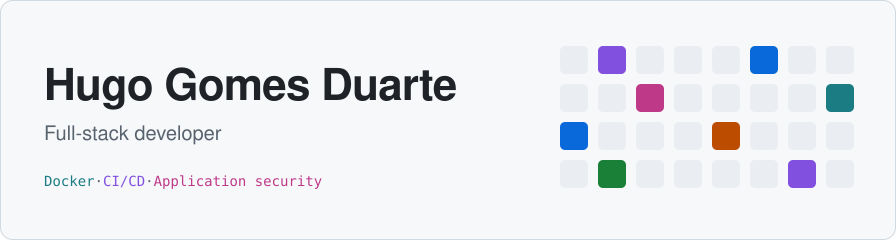
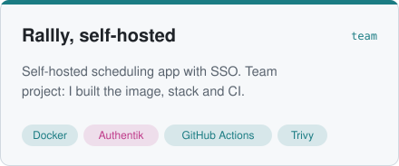
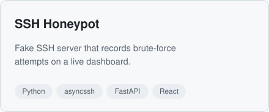
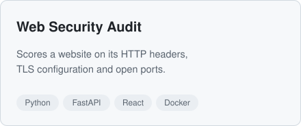
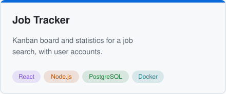
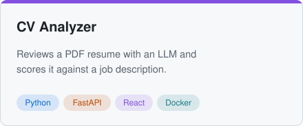
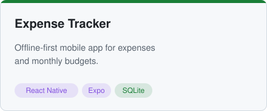
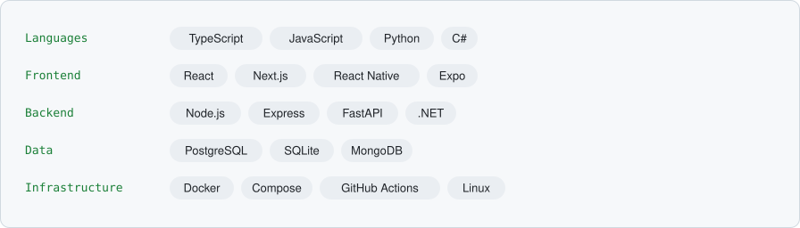

<picture><source media="(prefers-color-scheme: dark)" srcset="assets/header-dark.svg"><source media="(prefers-color-scheme: light)" srcset="assets/header-light.svg"></picture>

Master's student looking for a first developer role. I build web and mobile applications from the database to the interface, with a particular interest in containerized infrastructure and application security.

## Projects

<a href="https://github.com/HugoDGS/rallly"><picture><source media="(prefers-color-scheme: dark)" srcset="assets/rallly-dark.svg"><source media="(prefers-color-scheme: light)" srcset="assets/rallly-light.svg"></picture></a>
<a href="https://github.com/HugoDGS/ssh-honeypot"><picture><source media="(prefers-color-scheme: dark)" srcset="assets/ssh-honeypot-dark.svg"><source media="(prefers-color-scheme: light)" srcset="assets/ssh-honeypot-light.svg"></picture></a>

<a href="https://github.com/HugoDGS/web-security-audit"><picture><source media="(prefers-color-scheme: dark)" srcset="assets/web-security-audit-dark.svg"><source media="(prefers-color-scheme: light)" srcset="assets/web-security-audit-light.svg"></picture></a>
<a href="https://github.com/HugoDGS/job-tracker"><picture><source media="(prefers-color-scheme: dark)" srcset="assets/job-tracker-dark.svg"><source media="(prefers-color-scheme: light)" srcset="assets/job-tracker-light.svg"></picture></a>

<a href="https://github.com/HugoDGS/cv-analyzer"><picture><source media="(prefers-color-scheme: dark)" srcset="assets/cv-analyzer-dark.svg"><source media="(prefers-color-scheme: light)" srcset="assets/cv-analyzer-light.svg"></picture></a>
<a href="https://github.com/HugoDGS/expense-tracker"><picture><source media="(prefers-color-scheme: dark)" srcset="assets/expense-tracker-dark.svg"><source media="(prefers-color-scheme: light)" srcset="assets/expense-tracker-light.svg"></picture></a>

## Stack

<picture><source media="(prefers-color-scheme: dark)" srcset="assets/stack-dark.svg"><source media="(prefers-color-scheme: light)" srcset="assets/stack-light.svg"></picture>

## Contact

[LinkedIn](https://www.linkedin.com/in/hugo-gomes-duarte-05038b273)
